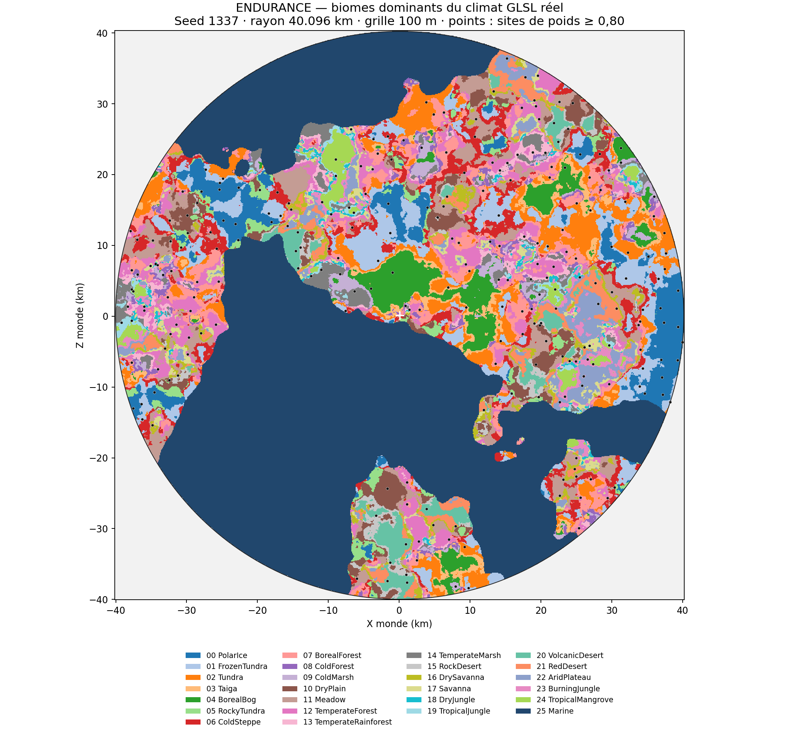

# ENDURANCE — superficie des biomes et implantation des sites

Mesure du 13 novembre 2026, après reconstruction des 25 recettes terrestres. Le relevé exécute le **classificateur GLSL de production et ses poids locaux**, sans forcer les biomes. Les ancres sont calculées par le même `landSite` que les recettes, puis évaluées avec le climat réel.

## Périmètre mesuré

La scène enregistrée utilise la seed **1337**, une caméra XZ **(80, 120) m** et `viewDistance = 40096`. Ce paramètre est transmis directement au sélecteur LOD et représente un **rayon de 40,096 km**, soit un diamètre de 80,192 km. Le relevé couvre ce disque en plan ; il ne signifie pas que tous ses chunks ont été chargés ou parcourus.

Grille de **100 m**, soit une surface échantillonnée d’environ **5 050,71 km²**. Les 25 biomes terrestres dominants sont présents. Leur surface cumulée vaut **2 962,49 km²**, contre **2 088,22 km²** pour le fond marin dominant. Le terrain procédural peut continuer au-delà de ce disque.



Les couleurs correspondent au biome ayant le poids le plus élevé à chaque point. Les points noirs sont les ancres dont le biome possède un poids local **≥ 0,80** ; la croix blanche indique la caméra enregistrée. Les contours colorés représentent une classification dominante, pas une rupture géométrique : le moteur interpole les contributions.

## Régions et sites

La surface totale d’un biome additionne ses occurrences séparées. La « plus grande région » est sa plus grande composante connexe à quatre voisins sur cette grille. Les nombres de sites sont ceux des ancres actives du biome concerné, pas ceux de la grille de placement si ce biome était forcé partout. Une ancre à poids fort ne garantit pas que toute sa sculpture reste dans le même biome.

| ID — Biome | Surface dominante (km²) | Plus grande région (km²) | Cellule de placement (km) | Ancres dans leur biome dominant | Dont poids ≥ 0,80 |
| --- | ---: | ---: | ---: | ---: | ---: |
| 00 — PolarIce | 205.39 | 72.87 | 2.40 | 31 | 25 |
| 01 — FrozenTundra | 290.56 | 57.79 | 2.20 | 33 | 22 |
| 02 — Tundra | 252.42 | 45.05 | 2.60 | 12 | 8 |
| 03 — Taiga | 83.40 | 9.06 | 2.80 | 4 | 2 |
| 04 — BorealBog | 159.68 | 96.66 | 2.50 | 11 | 4 |
| 05 — RockyTundra | 72.82 | 6.76 | 2.10 | 4 | 3 |
| 06 — ColdSteppe | 205.33 | 19.44 | 2.70 | 8 | 7 |
| 07 — BorealForest | 205.12 | 15.96 | 1.85 | 50 | 40 |
| 08 — ColdForest | 51.45 | 2.32 | 2.40 | 5 | 3 |
| 09 — ColdMarsh | 54.32 | 10.06 | 2.30 | 8 | 6 |
| 10 — DryPlain | 134.58 | 19.71 | 2.60 | 13 | 9 |
| 11 — Meadow | 234.98 | 16.57 | 2.40 | 21 | 18 |
| 12 — TemperateForest | 223.30 | 16.28 | 2.05 | 35 | 31 |
| 13 — TemperateRainforest | 63.37 | 11.05 | 2.20 | 14 | 13 |
| 14 — TemperateMarsh | 79.32 | 11.04 | 2.50 | 4 | 3 |
| 15 — RockDesert | 51.74 | 16.49 | 2.10 | 7 | 7 |
| 16 — DrySavanna | 67.06 | 5.63 | 1.80 | 14 | 12 |
| 17 — Savanna | 69.90 | 4.32 | 2.80 | 4 | 4 |
| 18 — DryJungle | 25.21 | 0.91 | 2.20 | 3 | 3 |
| 19 — TropicalJungle | 28.23 | 4.35 | 1.60 | 9 | 6 |
| 20 — VolcanicDesert | 94.89 | 18.79 | 2.60 | 12 | 11 |
| 21 — RedDesert | 100.86 | 17.23 | 2.90 | 7 | 6 |
| 22 — AridPlateau | 107.47 | 26.65 | 2.70 | 6 | 5 |
| 23 — BurningJungle | 41.52 | 6.28 | 2.50 | 4 | 4 |
| 24 — TropicalMangrove | 59.57 | 26.29 | 2.60 | 6 | 5 |

## Comparaison avec le personnage de 1,80 m

Les cellules de placement s’étendent de **1,6 à 2,9 km**, soit environ **890 à 1 610 hauteurs de personnage**. Elles définissent l’espacement potentiel des rencontres, avec des cellules vides ; elles ne représentent ni une distance exacte entre sites ni la largeur d’un passage. Le diamètre du support d’un site vaut 40 à 56 % de sa cellule, donc environ **640 à 1 624 m** selon la recette et la variante. La masse sculptée occupe seulement une partie de ce support.

Sur cette seed, les plus grandes régions connexes vont d’environ **0,91 km²** pour la jungle sèche à **96,66 km²** pour la forêt boréale marécageuse. Une formation peut donc être comparable à une petite région : les mélanges de biomes aux frontières doivent être examinés, même lorsqu’une ancre est bien placée. Les dégagements sous les toits et les vues à l’échelle du personnage sont mesurés séparément dans [la validation des reliefs et volumes](BIOME_REBUILD_VALIDATION.md).

## Ajustement issu de la mesure

La première implantation de `TropicalJungle`, avec des cellules de **2 400 m**, ne plaçait aucune ancre active dans son biome dominant sur ce disque, malgré **28,23 km²** de jungle tropicale et une plus grande région de **4,35 km²**. Les essais à 1 800, 1 600 et 1 400 m ont été comparés avec le même sel de seed et la même probabilité d’occupation.

L’espacement retenu de **1 600 m** donne **9 ancres dans leur biome dominant**, dont **6 à poids ≥ 0,80**. Parmi ces six variantes, **5 activent le volume** et **4 activent le portail** selon les seuils des recettes. Cela vérifie la présence des sites dans le climat réel ; cela ne certifie ni la forme finale après mélange, ni le passage d’une capsule. Le climat et les réglages de la scène restent inchangés.

## Reproduction et limites

```sh
LP_NUM_THREADS=2 EGL_PLATFORM=surfaceless python3 Tests/Terrain/check_biome_world_scale.py
```

Le script écrit [les métriques](biome-validation/world_scale.json) et [la carte](biome-validation/world_scale.png). Il lit les paramètres de la scène, le tableau des biomes C++ et les paramètres d’implantation des recettes. `climateFrequency` dans la scène est un ancien réglage ; les constantes effectives du climat se trouvent dans `Asset/Shader/Noise/climate_2d.glsl`.

- Exécution OpenGL 4.5 / Mesa llvmpipe : aucune mesure de performance sur le GPU du joueur.
- Surfaces planimétriques estimées, pas surfaces de triangles sur les pentes. Les chenaux et fragments inférieurs au pas de 100 m peuvent être omis ; la connexité varie avec la résolution.
- Les poids de surface et de volume sont vérifiés égaux sur tous les échantillons pour les matrices actuelles. Le test échoue s’ils divergent, afin de ne pas réutiliser silencieusement une mauvaise mesure.
- Trois coordonnées d’ancres alignées sur la grille sont vérifiées identiques bit à bit entre le classificateur inchangé et l’adaptateur de coordonnées.
- Une seule seed et un disque donné : ni taux mondial garanti, ni test de collision, ni garantie de traversée. Les sites coupés par la limite du disque sont comptés si leur ancre est à l’intérieur.
