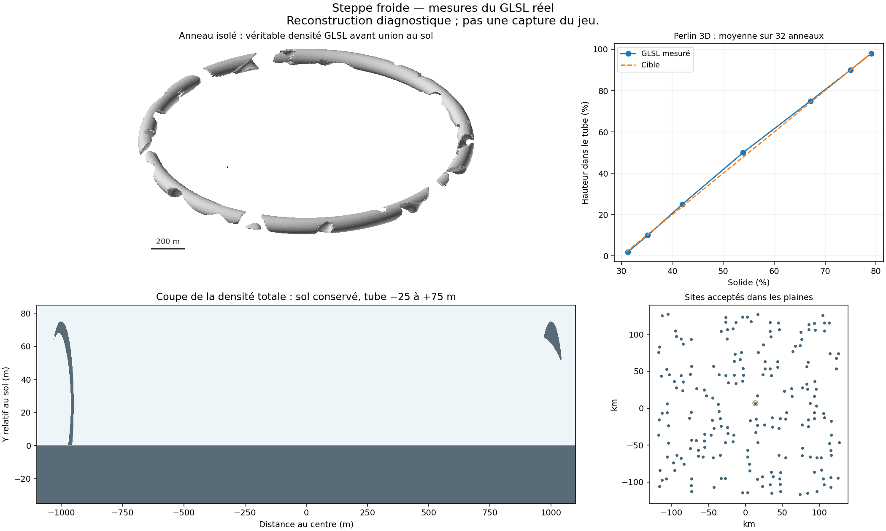

# Steppe froide : montagnes de la toundra gelée et anneaux poreux

ColdSteppe reprend les montagnes, plaines et cavernes de FrozenTundra. Les anciens
reliefs étagés, failles et petites sculptures de steppe sont remplacés. FrozenTundra
reste inchangée ; les copies dans ColdSteppe peuvent ensuite être réglées séparément.

## Montagnes : modifier la présence, conserver la forme

`Asset/Shader/ProceduralTerrain/biomes/ColdSteppe/regions.glsl` contient
`STEPPE_REGION_THRESHOLD = 0.14784`, contre `0.02` dans FrozenTundra. Avec la
formule actuelle, augmenter ce seuil réduit les régions montagneuses. La forme,
les dimensions et le multiplicateur de hauteur des massifs sont conservés.

La réduction de 20 % désigne la surface où le masque est au moins égal à 0,5,
mesurée sur un grand domaine. Elle ne signifie ni 20 points de pourcentage en
moins, ni des montagnes 20 % moins hautes. Sur 2 105 352 points et huit seeds,
le test mesure 19,99963 % de surface dominante en moins ; les résultats locaux
restent variables. Le fondu quintique et la transition large sont conservés.

## Dimensions et placement des anneaux

Les valeurs se règlent dans
`Asset/Shader/ProceduralTerrain/biomes/ColdSteppe/torus_settings.glsl`.

| Constante | Valeur | Sens |
|---|---:|---|
| `STEPPE_TORUS_RADIUS` | 1 000 m | Rayon du cercle au centre du tube |
| `STEPPE_TORUS_TUBE_RADIUS` | 50 m | Tube de 100 m de diamètre |
| `STEPPE_TORUS_BURIED_FRACTION` | 0,25 | 25 m de hauteur de tube sous le sol |
| `STEPPE_TORUS_SPACING` | 10 000 m | Une candidate par case de 10 × 10 km |
| `STEPPE_TORUS_PORE_SCALE` | 160 m | Échelle spatiale du Perlin 3D |

Les anneaux sont à plat : diamètre extérieur 2 100 m et ouverture centrale de
1 900 m. La section circulaire est calculée dans le plan distance radiale / Y
relatif au sol. Son centre vertical est à +25 m : l'enveloppe va de −25 à +75 m.
Elle suit donc les ondulations du terrain ; l'anneau entier n'est pas contraint
à un plan horizontal rigide. Le pourcentage enterré porte sur la hauteur du
tube, pas sur son volume.

Le hash de la case et du seed place le centre dans la moitié centrale de chaque
case. La distance entre centres candidats est au moins de 5 km. Une candidate
est acceptée ou rejetée en entier selon le masque montagneux de son voisinage.
Il n'y a pas de découpe d'un anneau à la frontière des montagnes. L'espacement
de 10 km est nominal : le rejet des régions montagneuses rend les anneaux
effectifs plus rares et ne garantit pas une rencontre tous les 10 km parcourus.

## Roche poreuse et terrain conservé

`torus.glsl` utilise la distance signée analytique du tore. La matière est
l'intersection de cette enveloppe et d'un Perlin 3D ; la création ajoute de la
roche par union avec le terrain et ne creuse pas le sol existant. L'ouverture
centrale reste le terrain initial, surmonté d'air.

`torus_porosity.glsl` fait monter la fraction de solide cible de 30 % au bas du
tube à 80 % en haut. Les seuils viennent de quantiles mesurés du bruit réel :
un Perlin ne possède pas une distribution uniforme. Ces pourcentages sont
statistiques sur plusieurs anneaux, avant l'union avec le terrain. Le sol
remplit naturellement les pores de la partie enterrée. L'échelle volontairement
large crée des variations locales : chaque anneau ne réalise pas exactement
les mêmes pourcentages.

Les dimensions des anneaux sont en mètres monde et restent indépendantes de
`uDetailScale`. Les montagnes copiées conservent leur comportement d'origine.
Aux frontières avec d'autres biomes, les poids de mélange peuvent atténuer les
ajouts comme pour les autres formations 3D.

Le contrat de bande existant impose néanmoins une limite : les contrôles ci-dessous
valident les échelles 0,2 / 0,35 / 1 avec décalage global nul. À une échelle très
faible, le plafond de 16 384 unités brutes peut tronquer les anneaux ; par exemple,
à 0,005 la bande totale maximale ne fait que 81,92 m. De grands décalages globaux
peuvent aussi tronquer un anneau dans un mélange de biomes, car le décalage et la
bande ne sont pas pondérés de la même façon. Le pipeline global reste inchangé.

## Vérification

```bash
EGL_PLATFORM=surfaceless python3 Tests/Terrain/check_cold_steppe_regions.py --output docs/biome-validation/cold_steppe_regions.json
EGL_PLATFORM=surfaceless python3 Tests/Terrain/check_cold_steppe_tori.py
```

Les sondes exécutent les fonctions GLSL de production. Le rapport des anneaux
est écrit dans `docs/biome-validation/cold_steppe_tori.json` : dimensions,
placement, absence de montagnes sous les sites acceptés, porosité selon Y,
conservation du sol, bandes 3D à plusieurs échelles, accumulation et raccords LOD.

Résultats de la validation sur llvmpipe :

- 370 sites acceptés sur 1 250 candidates, sur deux seeds ; les 1 142 560 points
  de contrôle dans leurs disques ont tous un masque montagneux nul.
- Écart maximal de 4,8 mm sur les points de l'enveloppe analytique sondée.
- 32 anneaux et sept tranches : fraction de solide à moins de 1,1 point de
  pourcentage de la cible. La calibration indépendante sur 128 anneaux mesure
  29,997 % à la base et 79,927 % au sommet.
- 16 384 échantillons mondiaux pour chacune des échelles 0,2 / 0,35 / 1 : aucune
  roche tronquée par la bande ; 6 144 points extérieurs par échelle restent de l'air.
- 84 sondes de frontières de placement, 1 331 densités du pipeline réel et
  125 points LOD partagés passent.
- Les colonnes mélangées utilisent les vrais poids et le vrai stockage de la
  matrice : trois poids de ColdSteppe à chacune des trois échelles, avec un
  contrôle volontairement contaminé par le biome voisin. L'admissibilité de
  l'anneau est recalculée et aucune roche positive attendue n'est tronquée à
  décalage nul. Ces sondes ciblées ne simulent pas le volume du biome voisin.



Ces contrôles hors jeu ne certifient pas les performances sur GPU Windows ni
les collisions du joueur.
