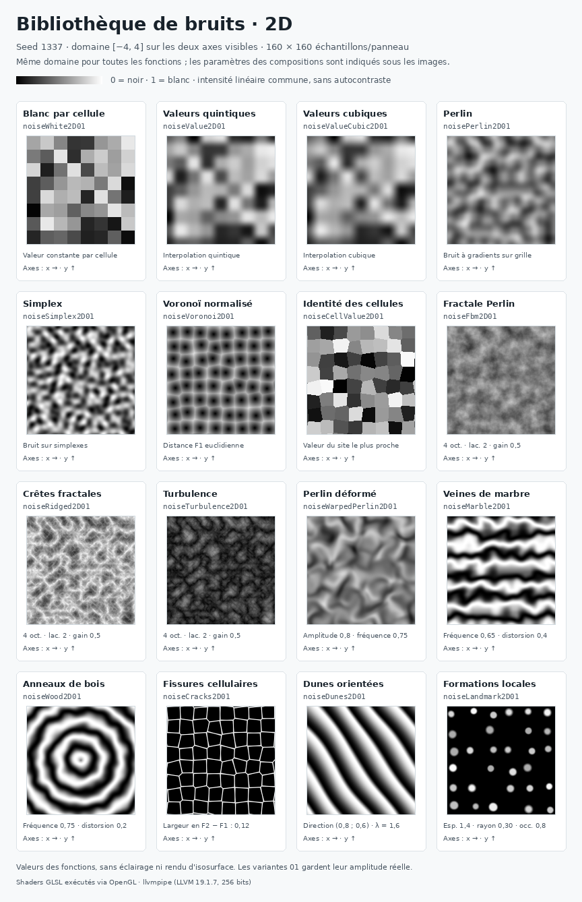
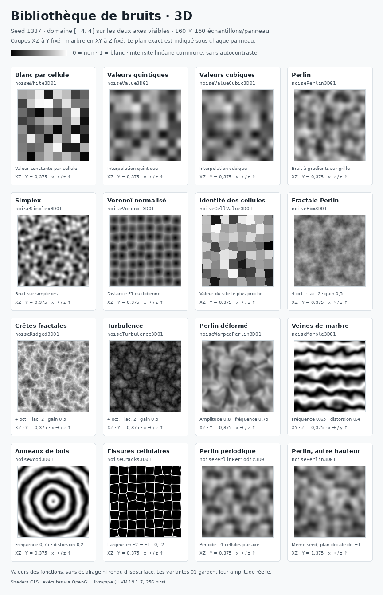

# Bibliothèque GLSL de bruits et de transformations

La bibliothèque se trouve dans `Asset/Shader/Noise/`. Elle fournit des fonctions
utilisables dans les recettes de biomes, les matériaux et les autres shaders,
sans dépendre d'un uniform, d'un buffer ou d'une texture du terrain.

Les outils sont classés en trois catégories :

1. **Bruits de base** : un motif élémentaire, comme Perlin, Simplex, value noise ou
   Voronoi. Les fonctions scalaires signées retournent `[-1,1]` ; leur variante
   terminée par `01` retourne `[0,1]`.
2. **Compositions spatiales** : octaves, crêtes, turbulence, déformation du domaine,
   dunes et autres motifs construits à partir des bases.
3. **Transformations de valeurs** : conversions, contraste, courbes, terrasses et
   opérations sur un champ signé. Elles ne génèrent pas elles-mêmes de bruit.

Les helpers nommés `noiseInternal...` sont des détails d'implémentation. Ils sont
placés au début de leurs fichiers et ne constituent pas le catalogue artistique.

## Fichiers et inclusions

| Fichier | Contenu |
| --- | --- |
| `Asset/Shader/Noise/noise_common.glsl` | Hash entier partagé, conversion de hash sur 24 bits, fades cubique/quintique, constantes de métrique et d'octaves. |
| `Asset/Shader/Noise/noise_shaping.glsl` | Transformations scalaires, quantification, profils de relief et combinaison de champs signés. |
| `Asset/Shader/Noise/noise_2d.glsl` | Helpers internes 2D, bases 2D, compositions et outils spatiaux 2D. |
| `Asset/Shader/Noise/noise_3d.glsl` | Helpers internes 3D, bases 3D, compositions et outils spatiaux 3D. |

## Aperçus issus des shaders

Les deux atlas comparent les fonctions avec la même seed `1337` et un domaine
visible `[-4,4]` sur chaque axe. Chaque panneau contient `160 × 160` valeurs
calculées par les shaders GLSL via OpenGL. L'intensité est commune à tous les
panneaux : `0` noir, `1` blanc, conversion linéaire vers 8 bits, sans ajustement
automatique du contraste. Un bruit visuellement plus gris a réellement une
amplitude plus concentrée dans cet exemple.



L'atlas 3D montre des **coupes du champ**, pas des surfaces maillées. Les coupes
sont dans le plan XZ à `Y=0.375`, sauf le marbre, montré dans le plan XY à
`Z=0.375` pour voir ses veines selon Y. Le dernier panneau montre Perlin à
`Y=1.375`, avec la même seed. Le plan et la coordonnée fixée figurent sous
chaque panneau.



Régénération depuis la racine du dépôt, avec Python, Pillow et le pilote
EGL/OpenGL Linux utilisé par les tests :

```sh
EGL_PLATFORM=surfaceless python3 Tests/Terrain/preview_noise_library.py
```

Options utiles : `--seed 42`, `--extent 6`, `--slice 1.25`, `--size 128`,
`--dimension 2` ou `--dimension 3`. Les deux PNG sont écrits dans `docs/images/`,
ou dans le dossier indiqué par `--output-dir`. Pillow n'est importé que par cette
commande de prévisualisation ; il n'est pas requis par la suite de tests de
bruit. Le pilote effectivement employé figure au bas de l'image, y compris
lorsqu'il s'agit de llvmpipe logiciel. Ces images servent à comparer les motifs,
pas à mesurer les performances d'un GPU matériel.

## Intégration dans un shader

Inclure la dimension nécessaire depuis le shader appelant. Les fichiers ont des
gardes d'inclusion et ne déclarent ni `#version` ni `main()`. Le chargeur de shaders
du moteur résout leurs directives `#include`.

Exemple depuis un shader situé directement dans `Asset/Shader/` :

```glsl
#include "Noise/noise_2d.glsl"

uniform uint uSeed; // État du shader appelant, pas de la bibliothèque.

float relief(vec2 worldXZ)
{
    uint seed = uSeed ^ 0x12345678u;
    float rolling = noiseFbm2D(worldXZ * 0.01, seed, 4, 2.0, 0.5);
    return noiseTerrace(rolling * 30.0, 4.0, 0.3);
}
```

La bibliothèque ne change pas le nombre de programmes du pipeline terrain. Une
fonction disponible n'ajoute aucun dispatch : c'est la recette qui décide de
l'appeler. Les recettes conservent une fonction `fieldRelief` et une fonction
`fieldVolume` par biome ; leurs sorties et les enveloppes de génération restent
des contrats du terrain.

## Dimensions, plages et seeds

`2D` signifie une position `vec2`, `3D` une position `vec3`. Pour une base ou une
composition scalaire, `noisePerlin2D(...)` est signé et
`noisePerlin2D01(...)` est sa version normalisée. `01` indique une plage de
valeurs, pas une distribution uniforme : une fonction bornée peut rarement
atteindre ses extrémités et une crête signée n'est pas nécessairement centrée
statistiquement sur zéro.

Les exceptions portent des noms explicites :

- `...Distance...`, `...DistancesSquared...` et `...Data...` fournissent des
  distances géométriques ou des métadonnées de cellules.
- `noiseDomainWarp2D/3D` et `noiseRotate2D` retournent des positions.
- `noiseCurl2D/3D` retournent des champs de dérivées, sans borne `[-1,1]`.
- `noiseRemap`, `noiseSnap`, `noiseTerrace`, `noiseSmoothMin` et
  `noiseSmoothMax` conservent les unités de leurs entrées.

Chaque fonction de bruit reçoit un `uint seed` explicite. Deux appels avec la
même position et la même seed suivent le même calcul ; une autre seed change
le motif. Le hash entier est celui du terrain optimisé, avec le même ordre
d'opérations. Les petits changements de recette doivent utiliser des sels
explicites au lieu de décaler de très grandes distances les coordonnées.

```glsl
float humidity = noisePerlin2D01(worldXZ * 0.001, uSeed ^ 0xa341316cu);
float volume = noisePerlin3D(worldPosition * 0.0125, uSeed ^ 0x299f31d0u);
```

Pour migrer un ancien appel `fieldNoise2(p, salt)`, transmettre
`noisePerlin2D(p, uSeed ^ salt)`, et de même pour la 3D. Le XOR appartient à
l'appelant ; il n'existe plus de seed globale cachée dans la bibliothèque.

L'ancienne composition de relief utilise `uSeed ^ (salt + octave)`. Ce calcul
est différent de `(uSeed ^ salt) + octave`. Le helper
`noiseFbmTerrain2D(p, worldSeed, salt)` conserve cette composition particulière,
ses trois fréquences, ses translations et ses poids, pour maintenir les reliefs
existants. Les nouvelles fonctions fBm générales ont leur propre contrat.

## 1. Bruits de base

Dans ce tableau, `D` représente `2D` ou `3D`, et `p` le vecteur correspondant.
Les variantes `01` utilisent les mêmes paramètres que la variante signée.

| Famille | Paramètres principaux | Usage et coût structurel |
| --- | --- | --- |
| `noiseWhiteD` / `noiseWhiteD01` | `p, seed` | Valeur aléatoire par cellule entière, discontinue aux frontières. |
| `noiseValueD` / `noiseValueD01` | `p, seed` | Valeurs aux sommets interpolées avec fade quintique ; 4 sommets en 2D, 8 en 3D. |
| `noiseValueCubicD` / `noiseValueCubicD01` | `p, seed` | Variante avec fade cubique, utile pour retrouver la famille de l'ancien `unity_valueNoise`. |
| `noisePerlinD` / `noisePerlinD01` | `p, seed` | Bruit à gradients sur une grille ; noyaux du terrain conservés, 4/8 gradients par évaluation. |
| `noiseSimplexD` / `noiseSimplexD01` | `p, seed` | Bruit sur simplexes ; famille différente du value noise, avec 3/4 coins par évaluation. |
| `noisePerlinPeriodicD` / `noisePerlinPeriodicD01` | `p, seed, period` | Perlin périodique ; `period` est un `ivec2/ivec3` en cellules de bruit, pas une distance monde. |
| `noiseVoronoiD` / `noiseVoronoiD01` | `p, seed[, metric]` | Distance F1 remappée avec une borne explicite. Petit près d'un site, plus grand loin du site. |
| `noiseCellValueD` / `noiseCellValueD01` | `p, seed[, metric]` | Valeur stable du site le plus proche, discontinue quand l'identité du site change. |

`ValueCubic` décrit la courbe d'interpolation entre les 4/8 sommets. Ce n'est
pas un filtre bicubique à 16 échantillons ou tricubique à 64 échantillons.

Perlin et « gradient noise » désignent ici la même grande famille de bruits à
gradients. L'ancien projet possédait plusieurs implémentations de cette famille,
pas deux concepts indépendants à exposer sous des noms ambigus.

### Distances cellulaires et métadonnées

```glsl
vec2 noiseCellularData2D(vec2 p, uint seed, int metric);
vec2 noiseCellularData3D(vec3 p, uint seed, int metric);
float noiseCellularDistance2D(vec2 p, uint seed, int metric);
float noiseCellularDistance3D(vec3 p, uint seed, int metric);
vec2 noiseCellularDistancesSquared2D(vec2 p, uint seed);
vec2 noiseCellularDistancesSquared3D(vec3 p, uint seed);
```

`Data` contient `(distance F1, valeur du site dans [0,1])`.
`DistancesSquared` contient `(F1², F2²)` avec la métrique euclidienne. Une valeur
de site sert à varier la forme, l'occupation ou la taille d'une formation locale.
Elle ne doit pas être employée comme déplacement continu non masqué à la
frontière entre deux sites.

Les fonctions `Data` et `Distance` ont également une surcharge sans `metric`,
qui choisit la métrique euclidienne.

Les métriques sont `NOISE_EUCLIDEAN`, `NOISE_MANHATTAN` et `NOISE_CHEBYSHEV`.
Les sites ont un jitter borné à `[0.35,0.65]` dans chaque cellule. Les bornes
conservatives suivantes utilisent déjà le site de la cellule courante :

| Dimension | Euclidienne | Manhattan | Chebyshev |
| --- | --- | --- | --- |
| 2D | `0.65 * sqrt(2)` | `1.30` | `0.65` |
| 3D | `0.65 * sqrt(3)` | `1.95` | `0.65` |

Les variantes Voronoi `01` divisent F1 par cette borne puis bornent le résultat
dans `[0,1]`. Les variantes signées appliquent ensuite `2*x-1`. **La distance
brute ne subit pas ce remappage.** F1 normalisé n'est pas une distance signée à
une surface.

La recherche porte sur 9 sites en 2D et 27 en 3D. Pour F1/F2 euclidiens en 3D,
un site hors du voisinage `[-1,1]^3` est distant d'au moins `1.35` sur un axe.
Le site courant est à au plus `0.65*sqrt(3)`. Un deuxième site, dans la cellule
voisine par la face la plus proche, a une distance au carré bornée par
`(1.15-delta)^2 + 2*(0.15+delta)^2`, avec `delta` dans `[0,0.5]`, donc par
`1.3675`. Ces deux sites sont plus proches que tout site extérieur. Cette
justification dépend du jitter borné ; elle ne vaut pas pour un remplacement
arbitraire des sites sur toute la cellule.

## 2. Compositions spatiales

Les fractales générales partagent les paramètres suivants :

```glsl
noiseFbm2D(p, seed, octaves, lacunarity, gain);
noiseFbm3D(p, seed, octaves, lacunarity, gain);
```

`octaves` est borné à `[0, NOISE_MAX_OCTAVES]`, avec
`NOISE_MAX_OCTAVES = 8`. La lacunarité est bornée à `[1,8]` et le gain à `[0,1]`.
La somme est normalisée par la somme des amplitudes effectivement utilisées.
Avec zéro octave, les variantes signées retournent `0`, les variantes `01`
retournent `0.5`. Des paramètres constants dans une recette permettent au
compilateur de simplifier plus facilement les boucles.

| Famille, disponible en 2D et 3D | Construction |
| --- | --- |
| `noiseFbmD` / `noiseFbmD01` | Octaves de Perlin signé. |
| `noiseValueFbmD` / `noiseValueFbmD01` | Octaves de value noise, avec poids normalisés. |
| `noiseSimplexFbmD` / `noiseSimplexFbmD01` | Octaves de Simplex. |
| `noiseTurbulenceD` / `noiseTurbulenceD01` | Octaves fondées sur la valeur absolue du bruit. |
| `noiseRidgedD` / `noiseRidgedD01` | Octaves de crêtes, à partir de `(1-abs(bruit))²`. |
| `noiseBillowD` / `noiseBillowD01` | Alias explicite de la turbulence, pour la convention de billow signée `2*moyenne(abs(bruit))-1`. |

Une fractale à huit octaves n'a pas le coût d'une seule base. La bibliothèque
rend ces compositions disponibles ; elle ne les active pas automatiquement
dans chaque biome.

Autres outils spatiaux :

| Fonction | Résultat / rôle |
| --- | --- |
| `noiseRidgeD` / `noiseRidgeD01` | Crête d'une seule évaluation Perlin ; la variante `01` vaut `1-abs(perlin)`. |
| `noiseVectorD(p,seed)` / `noiseVectorD01(...)` | Deux/trois composantes de Perlin avec seeds distinctes ; composantes dans `[-1,1]` / `[0,1]`, vecteur non unitaire. |
| `noiseDomainWarpD(p,seed,amplitude,frequency)` | Position déformée par un champ de bruit ; amplitude dans les unités de `p`, fréquence bornée à `>=0`. |
| `noiseWarpedPerlinD` / `noiseWarpedPerlinD01` | Perlin évalué après cette déformation, avec les mêmes quatre paramètres. |
| `noiseMarbleD` / `noiseMarbleD01` | Motif de veines ; paramètres `p,seed,frequency,distortion`. |
| `noiseWoodD` / `noiseWoodD01` | Motif d'anneaux ; paramètres `p,seed,frequency,distortion`. |
| `noiseCracksD` / `noiseCracksD01` | Motif cellulaire de joints ; paramètres `p,seed,width`. |
| `noiseCurlD(p,seed,epsilon)` | Dérivées par différences finies ; vecteur non normalisé, 4 Perlin en 2D et 12 en 3D. |
| `noiseRotate2D(p,direction)` | Rotation/changement de repère ; une direction unitaire conserve l'échelle. |
| `noiseDunes2D(p,direction,wavelength,seed)` / `noiseDunes2D01(...)` | Train de dunes à pente asymétrique et phase déformée. |
| `noiseLandmark2D(p,spacing,seed,metric,radius,crown,occupancy)` / `noiseLandmark2D01(...)` | Formations locales avec variation stable par site. |
| `noiseFbmTerrain2D(p,worldSeed,salt)` / `noiseFbmTerrain2D01(...)` | Les trois octaves historiques du relief, réservées à la conservation des recettes existantes. |

Pour les formations locales, `radius` est exprimé dans les unités de la grille
cellulaire, alors que `spacing` convertit la position vers cette grille. Garder
`radius < 0.35` assure un support disjoint des frontières de sites et évite que
leurs métadonnées discontinues deviennent visibles. Les variantes `01` de dunes,
landmarks et fissures désactivées retournent `0`, leurs variantes signées `-1`.

`noiseCracksD01` vaut `1` quand `F2-F1` est nul, puis décroît avec cette
différence. Son paramètre `width` n'est pas une épaisseur mesurée par une SDF de
la frontière. Le pas de dérivation du curl est `max(abs(epsilon),0.0001)` ; la
valeur doit encore être représentable à l'échelle de `p`. Les paramètres admis
et les protections propres à chaque outil sont détaillés immédiatement avant
sa définition GLSL.

Le marbre suit l'axe Y du domaine. Le bois forme des anneaux autour de
l'origine en 2D et autour de l'axe Y en 3D (`length(p.xz)`). Déplacer ou tourner
les coordonnées avant l'appel permet de changer le centre ou l'orientation.

## 3. Transformations de valeurs

Ces fonctions sont scalaires et n'ont pas de suffixe spatial `2D/3D`, puisqu'elles
transforment une valeur déjà calculée. Elles prennent des paramètres finis.

| Fonction | Contrat |
| --- | --- |
| `noiseTo01(x)` | `[-1,1]` vers `[0,1]`, sans clamp ; les autres valeurs sont extrapolées. |
| `noiseToSigned(x)` | `[0,1]` vers `[-1,1]`, sans clamp. |
| `noiseSaturate(x)` | Borne directement x dans `[0,1]`. |
| `noiseRemap(x,inMin,inMax,outMin,outMax)` | Remappage affine avec extrapolation ; intervalle d'entrée nul : `outMin`. |
| `noiseRemapClamped(...)` | Même remappage, facteur borné à `[0,1]` ; intervalles inversés acceptés. |
| `noiseContrast01(x,strength[,pivot])` | Contraste borné à `[0,1]`, pivot par défaut `0.5` ; facteur négatif accepté. |
| `noiseTriangle01(x)` | Pic à `0.5`, zéro à `0` et `1` ; x borné à `[0,1]`. |
| `noiseGamma01(x,gamma)` | `pow(x,gamma)` avec x dans `[0,1]` et gamma forcé à `>=0.0001`. |
| `noiseConcave01(x)` / `noiseConvex01(x)` | `sqrt(x)` / `x*x` après borne `[0,1]`. |
| `noiseSineEase01(x)` | Transition sinusoïdale de `0` à `1`, avec pentes nulles aux extrémités. |
| `noiseBias01(x,bias)` | Courbe rationnelle ; bias `0.5` : identité, plus petit : valeurs abaissées. |
| `noiseGain01(x,gain)` | Courbe symétrique autour de `0.5` ; gain `0.5` : identité, plus grand : contraste accru. |
| `noiseSmoothstep(edge0,edge1,x)` | Transition cubique robuste ; bords égaux : `step`, inversés : transition décroissante. |
| `noiseQuantize01(x,levels)` | Arrondi au plus proche de `levels` niveaux, extrémités `0/1` incluses. |
| `noiseTerraces01(x,levels,softness)` | Mêmes niveaux, avec rampes cubiques de largeur réglable ; softness `0` : seuil dur. |
| `noiseSnap(value,strength)` | Attraction vers `round(value)` ; force bornée `[0,1]`, unités conservées. |
| `noiseMound01(distance,radius)` | Bosse radiale compacte ; rayon non positif : profil nul. |
| `noiseMesa01(distance,radius,crown)` | Plateau puis bord adouci ; crown `1` : bord dur, rayon non positif : profil nul. |
| `noiseTerrace(height,stepHeight,softness)` | Terrasses en unités monde, hauteurs négatives acceptées ; pas non positif : hauteur conservée. |
| `noiseSmoothMin(a,b,radius)` / `noiseSmoothMax(...)` | Combinaison polynomiale de champs signés, sans normalisation ; rayon non positif : min/max ordinaire. |

`levels` est un nombre **entier de niveaux incluant les deux extrémités**, borné
à `[2,16777216]`. Avec `levels=5`, les plateaux sont `0, 0.25, 0.5, 0.75, 1`.
La borne supérieure correspond à la précision d'un float ; augmenter davantage
ce paramètre ne crée pas de précision supplémentaire. `softness` est borné à
`[0,1]`. À `1`, une rampe cubique occupe chaque intervalle ; ce n'est pas une
interpolation linéaire.

Les biais et gains sont bornés à `[0.0001,0.9999]`. Les deux extrémités `0/1`
restent fixes. Les paramètres dégénérés ont une définition explicite, et les
transitions si étroites que leurs bords s'arrondissent au même float deviennent
des seuils durs.

Les courbes `noiseFadeCubic` et `noiseFadeQuintic` du fichier commun acceptent
`float`, `vec2` et `vec3`. Leur domaine est `[0,1]` par composante, sans clamp
implicite. La cubique remplace l'ancien `smoothStepCurve` sur ce domaine ; employer
`noiseFadeCubic(noiseSaturate(x))` pour conserver son écrêtage hors du domaine.
La quintique a ses dérivées première et seconde nulles aux extrémités et convient
aux raccords C2.

Les min/max adoucis conservent les unités du champ. Un minimum peut descendre de
`radius/4` sous le minimum dur, et un maximum monter d'autant. Pour une SDF avec
intérieur négatif, le minimum réalise une union ; dans le terrain Endurance,
**la densité positive signifie solide**, il faut donc choisir l'opérateur selon
cette convention. Ce ne sont pas des moyens de borner une densité dans `[-1,1]`.

## Domaine des coordonnées et limites pratiques

Les paramètres doivent être finis ; la bibliothèque ne convertit pas les NaN ou
infinis en valeurs de terrain arbitraires. Il faut également que les opérations
intermédiaires restent finies.

Pour les bases sur grille, les coordonnées converties en cellules entières,
ainsi que les voisins visités, doivent rester dans un domaine entier valide.
Utiliser la marge conservatrice `abs(latticeCoordinate) < 2^30` après les
transformations. Cela comprend la déformation du domaine, les octaves et le
changement de base du Simplex, pas seulement la position fournie au premier
appel. Au-delà de `2^24`, un float32 ne représente même plus chaque entier
consécutif ; la finesse sous la cellule se perd bien avant de dépasser un int32.
Un domaine techniquement convertible ne garantit donc pas une finesse visuelle
suffisante.

Avec n octaves, tenir compte de la fréquence maximale réellement évaluée,
approximativement `baseFrequency * lacunarity^(n-1)`. La périodicité ne corrige
pas une conversion entière invalide faite avant le modulo ; les périodes sont
bornées composante par composante à `[1,2^24]`. Pour les dérivées par différences
finies, `epsilon` doit rester assez grand pour que `p+epsilon` et `p-epsilon`
soient distincts dans la précision des coordonnées utilisées.

Le contrôle CPU `validFieldDomain()` du terrain contient actuellement une
fréquence conservatrice de `0.25` pour ses recettes. Ajouter des fonctions à la
bibliothèque ne modifie pas cette hypothèse. Une recette qui utilise davantage
d'octaves, une fréquence supérieure ou un warp plus large doit vérifier cette
hypothèse et, si nécessaire, faire évoluer explicitement ses bornes CPU.

## Migration et corrections des archives

Les fichiers historiques de `Asset/Shader/Noise_old/` sont des références
d'anciens kernels complets. Leur reprise n'est pas une inclusion directe : ils
contiennent leurs uniforms, leurs buffers, leurs `main()` et plusieurs copies
des mêmes fonctions.

| Ancien nom / emplacement | API à utiliser |
| --- | --- |
| `fieldNoise2`, `fieldNoise3` du terrain optimisé | `noisePerlin2D/3D(p, uSeed ^ salt)` ; noyaux et hash conservés. |
| `fieldUnsignedNoise` | `noisePerlin2D01(p, uSeed ^ salt)`. |
| `fieldRidge2` | `noiseRidge2D01`, car l'ancien résultat était déjà dans `[0,1]`. |
| `fieldCellular2Data/3Data` | `noiseCellularData2D/3D`, en conservant les distances brutes. |
| `fieldCellular2Distances` | `noiseCellularDistancesSquared2D` : les deux composantes sont des distances au carré. |
| `fieldSurfaceFbm` | `noiseFbmTerrain2D(p,uSeed,salt)` pour conserver exactement ses trois octaves. |
| `fieldSurfaceRotate/Mound/Mesa/Terrace/Dune/Landmark` | `noiseRotate2D`, `noiseMound01`, `noiseMesa01`, `noiseTerrace`, `noiseDunes2D01`, `noiseLandmark2D01`. |
| `contrast`, `courbe01` du terrain | `noiseContrast01`, `noiseTriangle01` ; expressions conservées sur les domaines valides. |
| `unity_valueNoise` des archives | `noiseValueCubic2D01/3D01` pour la famille cubique ; le nouveau hash change le motif ancien. |
| `SimpleNoise`, section ancienne `<SIMPLEX3D>` | Famille `noiseValueFbm2D/3D` ; ce n'était pas du Simplex. La nouvelle composition est normalisée. |
| `perlin`, `gradientNoise` des archives | `noisePerlin2D/3D`, ou variante `01` selon la plage voulue ; les anciennes variantes ne partagent pas toutes le même motif. |
| `Voronoi_float`, `Voronoi3D` | `noiseCellularDistance2D/3D` pour une distance brute, `noiseVoronoi2D/3D[01]` pour un bruit borné. |
| `toSigned`, `toUnsigned` | `noiseToSigned`, `noiseTo01`, après vérification de la plage réelle de l'entrée. |
| `discretize`, `smoothDiscretize` | `noiseQuantize01`, `noiseTerraces01` avec le nouveau contrat de nombre de niveaux. |
| `concave/concave2`, `convex/convex2`, `sineEase` | Une seule fonction par forme : `noiseConcave01`, `noiseConvex01`, `noiseSineEase01`. |
| `snapToNearestInt` | `noiseSnap`. |

Les erreurs anciennes corrigées sont notamment :

- `gradientNoise2D + 0.5` ne garantissait pas `[0,1]` ; un simple décalage n'est
  pas une normalisation de l'amplitude.
- `SimpleNoise` additionnait des poids totalisant `7/8` : enveloppe `[0,0.875]`
  en 2D et `[-1,0.75]` en 3D après son remappage, au lieu des plages annoncées.
- `discretize(1,L)` donnait `L/(L-1)`, supérieur à `1` ; `L=1` divisait par zéro.
- `smoothDiscretize(...,transition=0)` appelait `smoothstep` avec deux bords
  égaux, sans définition explicite ; `levels=0` divisait également par zéro.
- `fieldUnsignedVoronoi` ajoutait `0.5` à une demi-distance déjà positive. Le
  nouveau bruit Voronoi utilise une vraie borne par dimension et par métrique.
- Les sites de Voronoi anciens parcouraient toute la cellule. La justification
  du voisinage borné actuel repose sur son jitter plus restreint.

`noise_opaque_old.fs.glsl` est un shader d'affichage d'un buffer de valeurs,
pas une collection de bruits. `applyHeightTransition`, les mélanges de matrices
de biomes et les kernels de min/max restent des fonctions de pipeline terrain,
hors de cette bibliothèque générale.

## Repères algorithmiques

- Ken Perlin, [Improved Noise — implémentation de référence](https://cs.nyu.edu/~perlin/noise/).
- Stefan Gustavson, [Simplex noise demystified](https://itn-web.it.liu.se/~stegu76/simplexnoise/simplexnoise.pdf).

Ces références décrivent les familles d'algorithmes. Les contrats de seed, de
normalisation et de compatibilité du projet sont ceux des fonctions GLSL de
cette bibliothèque ; ils ne doivent pas être déduits des archives ou du seul
nom historique d'un bruit.
