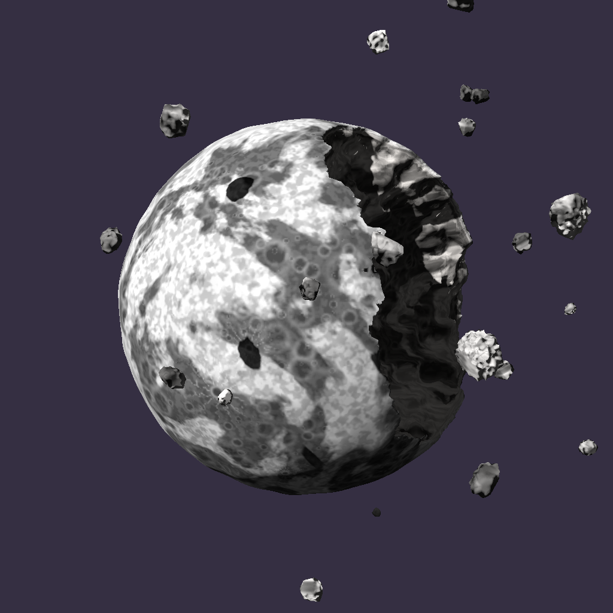
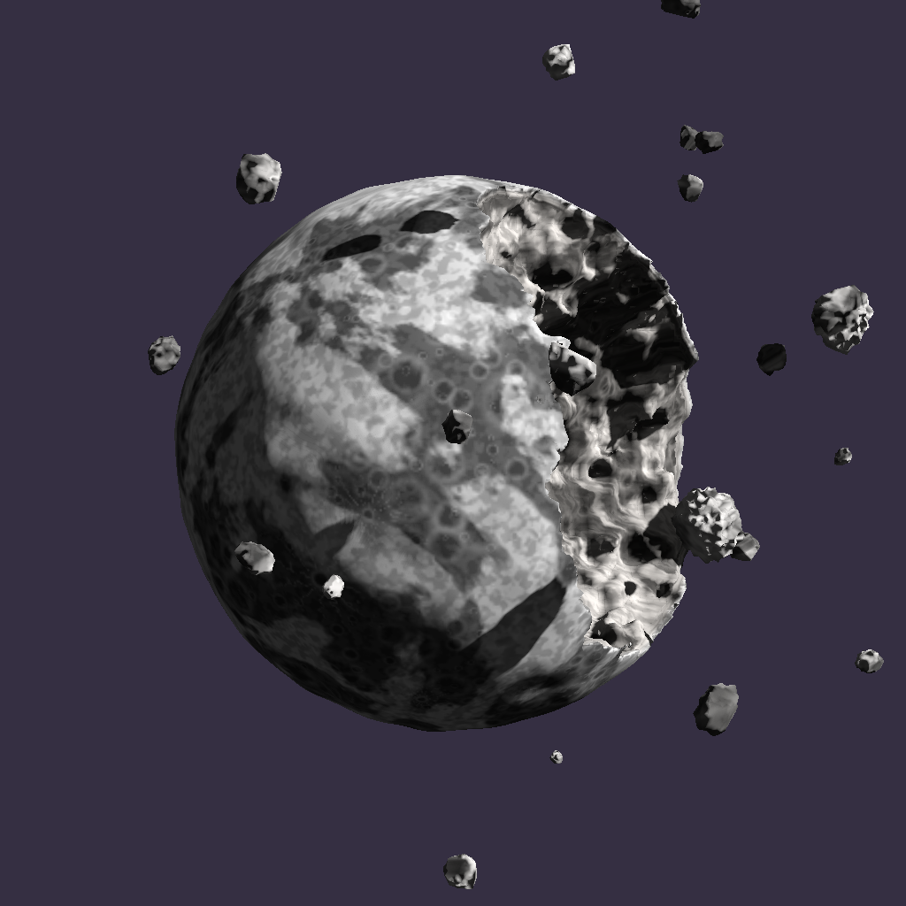

# Laboratoire de sculpture lunaire

Ouvrir `ENDURANCE/Scene/MoonGeneratorLab.scene`, puis lancer **Play**. Le
laboratoire génère maintenant un **vrai maillage creusé**, avec des parois
intérieures, une silhouette entamée et des fragments détachés. La génération
est native C++ ; elle ne dépend pas de Python, de Houdini ou d'un service externe.

Le preset propose une grande excavation asymétrique, des arrachements secondaires
et des roches dispersées. Il sert de point de départ pour une lune qui se disloque.
La référence visuelle guide la silhouette et les volumes ; le fond violet et la
lumière se règlent dans l'aperçu et ne sont pas peints dans le matériau.



## Utilisation

- Les panneaux restent attachés à la fenêtre principale et suivent sa taille.
- Glisser dans l'aperçu pour tourner autour du modèle ; molette pour zoomer.
- Modifier le soleil pour examiner les ombres dans les cavités. Les modes
  normales et fil de fer permettent de vérifier la forme et sa résolution.
- La seed reproduit la forme et le matériau. « Variante suivante » propose une
  nouvelle réalisation sans changer les autres réglages.
- L'aperçu automatique attend la fin des modifications avant de recalculer.
  Un seul travail CPU est actif, annulable ; la dernière image reste affichée.
- L'export est explicite. L'ouverture du laboratoire et les essais n'écrivent
  aucun modèle dans le projet.

## Contrôles

| Groupe | Réglages |
| --- | --- |
| Volumes arrachés | Intensité, nombre de cavités, taille, profondeur, direction et élévation de destruction. |
| Parois et érosion | Amplitude, fréquence et octaves du bruit géométrique. |
| Fragments | Nombre, taille et dispersion des morceaux. |
| Roche | Fréquence des mers sombres, fréquence des détails et octaves du matériau. |
| Qualité | Résolutions distinctes du maillage et de la texture pour l'aperçu et l'export. |
| Aperçu | Orbite, zoom, soleil, exposition, ambiance, ombres, normales et fil de fer. |

Les distances géométriques sont relatives au rayon de la lune intacte, fixé à 1.
L'intensité de destruction à zéro produit une lune intacte et retire les débris.
La résolution géométrique utilise 32 à 256 cellules par côté pour l'export,
32 à 128 pour l'aperçu. La texture finale va de 128 à 4096 pixels de large,
avec un ratio 2:1. Les paramètres hors limites sont bornés à la lecture.

## Génération et coût

Le corps est décrit par un champ implicite. Des volumes d'excavation orientés,
déformés par un bruit simplex composé, sont soustraits à la sphère. Une extraction
indexée par tétraèdres produit la surface. Une simplification par erreur
quadratique réduit ensuite les faces tout en protégeant la topologie et les
changements d'orientation. Les fragments sont des volumes rocheux fermés avec
anisotropie et plans de cassure ; ils ne représentent pas une simulation physique
de fracture ni une conservation exacte de la masse retirée.

Les grandes formes sont dans les triangles. Les petites variations lunaires,
les impacts et les éjecta sont calculés hors jeu dans la texture d'albédo.
Les normales de l'ancienne texture sphérique ne sont pas appliquées aux parois
intérieures : leur orientation provient du nouveau maillage.

La modification de la texture réutilise le maillage si ses paramètres n'ont pas
changé, et réciproquement. Tourner la caméra ou déplacer le soleil ne relance pas
le générateur. L'aperçu utilise un dessin indexé et une carte d'ombres locale
D24 de 2048², conservée tant que le soleil et le maillage ne changent pas.
Une vue entièrement inchangée conserve également son image. Aucun bruit
volumétrique ni raymarch n'est recalculé dans le fragment shader de l'aperçu.
Les modes de diagnostic sont des variantes GLSL compilées.

Le budget final dépend de la précision et de l'érosion. Le panneau affiche le
nombre réel de sommets, triangles et morceaux ainsi que le temps du dernier
calcul CPU. Il ne s'agit pas d'une mesure des FPS du jeu.

Le preset livré (seed 68291, direction 60°, 24 fragments) exporté à résolution
128 contient **46 031 sommets et 90 560 triangles**, dont environ 80 000 pour
le corps. Le bake complet avec texture 2048 × 1024 et export prend environ
**6,6 secondes** sur l'environnement Linux de validation ; le GLB occupe
environ **5,4 Mio**. Ces valeurs ne mesurent pas le PC du joueur.



## Export

Chemin par défaut depuis `Bin` :
`../ENDURANCE/Ressources/Model/Moon/Baked/moon.glb`.

Le fichier **GLB** contient le maillage, une texture PNG d'albédo sans lumière,
le matériau opaque rugueux, les couleurs de matériau par sommet et la recette
de génération dans `extras`. Le corps et chaque fragment sont des nœuds séparés,
avec leurs propres plages compactes de sommets et d'indices. La texture est
commune. Les coordonnées gardent le rayon de référence 1 ; appliquer l'échelle
physique à l'intégration dans le jeu.

L'albédo du générateur est linéaire ; le PNG du matériau glTF est encodé en sRGB.
Les multiplicateurs de couleur des sommets restent linéaires. L'éclairage et les
ombres de l'aperçu ne sont jamais exportés dans la couleur. Le format `.gltf`
est également accepté avec données et texture intégrées, mais le GLB évite le
surcoût du base64. L'écriture remplace un seul fichier complet ; un échec laisse
l'ancien export intact.

**Ce laboratoire ne remplace pas encore le rendu de la scène Terrain.** Le jeu
continue à lire `moon.surface` et à afficher sa sphère analytique. Le modèle
exporté prépare la prochaine intégration du maillage dans le ciel, les nuages,
l'atmosphère et les reflets. Il ne faut pas remplacer `moon.surface` par un GLB.
Les anciens chemins `.surface` des scènes de laboratoire sont migrés vers le
nouveau chemin pour éviter cet écrasement.

## Outils natifs et vérification

```sh
cmake -S Tools -B build/moon-bake -DCMAKE_BUILD_TYPE=Release
cmake --build build/moon-bake --config Release
```

`endurance_moon_model --output chemin/moon.glb` utilise le même générateur que
la scène. `--help` liste les réglages. `endurance_moon_bake` reste disponible
pour produire l'ancien atlas `moon.surface`, utilisé par le jeu actuel.

```sh
Tests/Atmosphere/check_moon_geometry.sh
Tests/Atmosphere/check_moon_bake.sh
python Tests/Atmosphere/check_moon_lab.py
python Tests/Atmosphere/check_moon_lab.py --fast-math
```

Les scripts Python éventuels lancent les tests et un contexte OpenGL ; ils ne
créent pas la géométrie. Validation native et OpenGL sous Linux/Mesa llvmpipe.
Le build MSVC complet et l'essai interactif sur GTX 1660 restent à vérifier.

Les suites standard et fast-math valident la fermeture et l'orientation du
maillage, les normales, les résolutions 32/96/128, plusieurs réglages extrêmes,
le déterminisme, l'annulation, les exports GLB/glTF avec PNG, les ombres réelles,
la restauration de l'état GL, les caches et le cycle d'ouverture du panneau.
