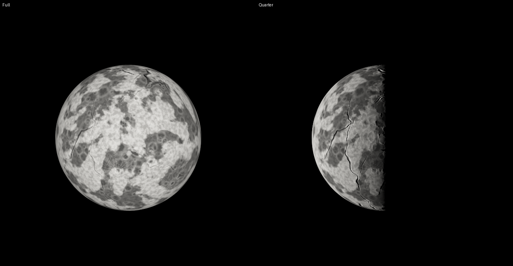

# Laboratoire lunaire natif

Le laboratoire fabrique une lune procédurale fissurée en **C++**, hors du rendu
du jeu. Il partage son générateur avec l'outil natif en ligne de commande ;
Python n'intervient pas dans la création de la surface.

## Utilisation dans ENDURANCE

Ouvrir `ENDURANCE/Scene/MoonGeneratorLab.scene`, puis lancer **Play**.
Le panneau du laboratoire est attaché à la fenêtre principale. Régler la seed,
les deux échelles de bruit, les octaves et les fractures, puis régénérer l'aperçu.
L'aperçu utilise une résolution réduite pour les essais ; l'export calcule la
résolution finale choisie. Un seul travail CPU est autorisé à la fois.

Le bouton d'export enregistre le fichier `moon.surface` au chemin affiché.
Le chemin par défaut est celui qu'utilise la scène Terrain :
`../ENDURANCE/Ressources/Atmosphere/moon.surface`, depuis le répertoire `Bin`.
Les essais et l'ouverture du laboratoire n'écrivent pas automatiquement cet asset.
Après export, redémarrer la scène Terrain pour charger la nouvelle version.

## Réglages de génération

| Paramètre | Rôle |
| --- | --- |
| Seed | Reproduit le même paysage et le même réseau de fractures. |
| Macro scale | Fréquence des grandes mers sombres. |
| Detail scale | Fréquence des variations minérales plus fines. |
| Octaves | Détails du fBm, filtrés selon la résolution de la texture. |
| Fracture count | Nombre de grandes failles ; des branches secondaires leur sont rattachées. |
| Fracture width | Largeur relative des failles sur la sphère. |
| Fracture depth | Profondeur utilisée pour produire les normales des parois. |
| Fracture strength | Intensité globale ; zéro permet une lune intacte. |
| Width | Résolution finale de l'atlas 2:1 ; 2048 conserve le budget du jeu. |

Le preset livré utilise la seed **68291**, 9 grandes failles, une demi-largeur
angulaire de **0.018**, une profondeur relative de **0.025** et une intensité
de **1.25**. Les deux fréquences sont 2.4 et 18, avec jusqu'à 8 octaves.
Le remplacement du générateur change la réalisation aléatoire par rapport à
l'ancien script, tout en conservant la méthode et la palette lunaire.

Les grandes failles sont des tracés sinueux définis sur la sphère, avec une
largeur variable. Elles modifient le relief dont sont dérivées les normales et
l'albédo des roches exposées. Le réseau n'est pas une grille de Voronoï régulière.
Les bruits sphériques, les cratères et les fractures sont calculés avant l'export.
L'albédo moyen est conservé près de celui de la lune précédente pour limiter
les changements de puissance de la lumière lunaire.

## Budget et limites

La sortie conserve le format **EMOON001**, normal objet RGB et albédo A, RGBA8
linéaire. À 2048 × 1024, elle occupe 8 Mio avant mipmaps, environ 10,67 Mio après.
Les shaders, les lectures de texture et le nombre de passes du jeu ne changent
pas. Le worker et les textures d'aperçu sont propres au laboratoire.

Cette version représente des **fissures de surface**. La sphère conserve sa
silhouette ; les creux ne sont pas des trous traversants et aucun morceau ne
flotte autour de la lune. Les normales ne projettent pas d'ombres entre parois.
Ces limites permettent de conserver le chemin de rendu actuel, y compris les
phases, l'atmosphère, les nuages et les reflets.

## Outil natif facultatif

La scène suffit pour créer et exporter la lune. Pour automatiser un bake sans
ouvrir le moteur, depuis la racine du dépôt :

```sh
cmake -S Tools -B build/moon-bake -DCMAKE_BUILD_TYPE=Release
cmake --build build/moon-bake --config Release
```

L'exécutable `endurance_moon_bake` est dans le répertoire de build (dans
`Release` pour un générateur Visual Studio). Consulter `--help` pour les options.
Il utilise `ProceduralMoon.cpp`, exactement comme le laboratoire.

Les tests automatisés peuvent utiliser Python pour lancer le contexte OpenGL
existant ; cela ne constitue pas une dépendance de génération ou du jeu.

## Vérifications

```sh
Tests/Atmosphere/check_moon_bake.sh
python Tests/Atmosphere/check_moon_lab.py
python Tests/Atmosphere/check_moon_lab.py --fast-math
python Tests/Atmosphere/check_moon.py
python Tests/Atmosphere/check_game_component.py
```

Le générateur natif est testé en C++17 normal et fast-math : seed, normales,
albédo, couture sphérique, paramètres invalides, annulation, format binaire et
remplacement sûr du fichier. Le laboratoire est exercé avec le vrai ImGui et
OpenGL : sérialisation, publication sur le thread de rendu, état GL, résultats
périmés, export et arrêt du worker. Les shaders existants valident phases,
nuages, atmosphère et reflets avec le nouvel atlas.

Le bake natif 2048 × 1024 prend environ **3 secondes sur l'environnement Linux
de validation**. Ce n'est pas une mesure sur le PC du joueur. Les tests de rendu
utilisent Mesa llvmpipe ; le build complet MSVC et la validation interactive
sur GTX 1660 restent à effectuer.


