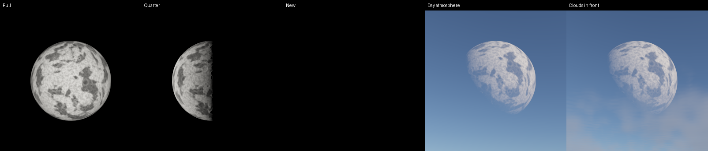
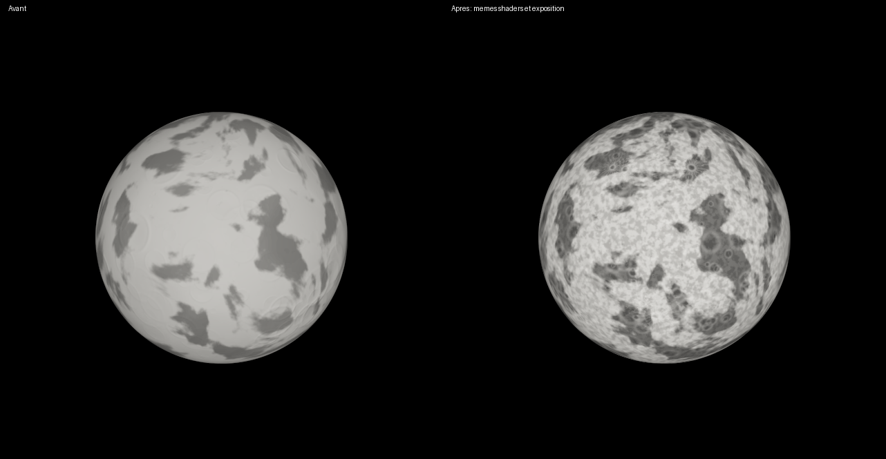

# Lune d'ENDURANCE

La scène `ENDURANCE/Scene/Terrain.scene` active une lune proche, de **20° de
diamètre apparent** à l'origine du monde. Son centre est à 1 000 km, au-dessus
de l'horizon à 25°. Sa position reste fixe dans le monde : les déplacements
du joueur produisent une parallaxe. Le rayon angulaire et la distance sont des
choix artistiques, pas les valeurs de la Lune terrestre.



## Réglages

Dans les paramètres de l'atmosphère :

| Paramètre | Effet |
| --- | --- |
| `Textured lunar sphere` / `moonSurface` | Active la sphère texturée ; désactivé, conserve l'ancien disque des scènes existantes. |
| `Moon angular radius (degrees)` | Rayon apparent à l'origine ; valeur de scène : 10°. |
| `Moon centre distance (m)` | Distance depuis `(0, seaLevel, 0)` ; la taille physique est déduite du rayon angulaire. |
| `Moon surface rotation (degrees)` | Tourne les taches et les cratères sur l'astre. |
| `Moon relief strength` | Force des normales des cratères ; valeur de scène : 0.65. |
| `Moon disk color` / `Moon disk HDR intensity` | Teinte et gain de la lumière réfléchie, également pris en compte pour l'éclairage. |
| `Moon illumination multiplier` | Ajustement artistique de la lumière directe et de la diffusion atmosphérique ; 1 conserve la calibration de la sphère. |
| `Optional moon light` | Source directionnelle associée ; la scène sélectionne `Moon`, index 1. |

Tourner l'objet **Moon** déplace l'astre. Les angles de secours `Moon fallback
azimuth/elevation` ne servent que lorsqu'aucune lumière lunaire n'est associée.
Le déplacement orbital automatique n'est pas implémenté. La phase évolue lorsque
la direction du soleil ou de la lune change.

La lumière de la lune est calculée depuis celle du soleil, l'albédo moyen de
la surface, la taille angulaire et la phase lambertienne. Les valeurs génériques
de couleur/intensité de l'objet `Moon` ne remplacent pas ce calcul ; utiliser les
contrôles de l'atmosphère ci-dessus. La nouvelle lune n'émet pas de lumière.

Les ombres terrain de **Moon** sont désactivées dans la scène par défaut pour
éviter un second jeu de cascades. Activer sa case **Shadow** utilise le système
existant, y compris son interaction avec les volumes atmosphériques. Sans ces
ombres, cette lumière directe n'est pas occultée par les reliefs. Les nuages
atténuent déjà sa lumière, indépendamment de cette case.

## Rendu et séparation moteur / jeu

- Le jeu charge `ENDURANCE/Ressources/Atmosphere/moon.surface` via
  `EnduranceAtmosphereComponent::moonSurfaceFile`. Le moteur reçoit ses pixels
  par `Atmosphere::setMoonSurface` et possède la copie GPU. Chargement à
  l'activation et au changement de chemin ; aucune lecture du fichier par image.
- `Asset/Shader/Atmosphere/moon_surface.glsl` intersecte analytiquement une
  sphère, calcule ses UV et l'éclaire par le soleil. La surface n'utilise aucun
  bruit procédural ni raymarch à l'exécution. Les normales donnent un relief
  d'éclairage, sans modifier la silhouette ni projeter des ombres entre cratères.
- La texture linéaire **RGBA8 2048 × 1024** contient les normales en RGB et
  l'albédo en A. Les mipmaps filtrent les détails lointains. Elle occupe environ
  **10,67 Mio** avec ses mipmaps.
- Un UBO séparé de 32 octets contient le centre relatif à la caméra, le rayon et
  les contrôles de surface. L'ABI du bloc atmosphère existant reste inchangée.
- Le ciel visible applique la transmittance atmosphérique par direction et
  réutilise l'alpha de la texture des nuages existante pour leur occultation.
  Aucun nouveau raymarch des nuages par pixel lunaire à pleine résolution.
- La capture de l'environnement utilise une entrée supplémentaire pour les
  reflets GGX, contenant la lune mais pas le disque solaire. À 256² par face,
  elle représente environ **4 Mio** avec ses mipmaps. Les captures et les fondus
  restent répartis entre plusieurs images comme auparavant.
- Avec une lumière lunaire associée, le disque est exclu de l'irradiance diffuse
  de l'IBL, et le reflet ponctuel de cette lumière est supprimé lorsque l'IBL est
  prêt. Cela évite de compter deux fois sa contribution. Sans lumière associée,
  l'IBL inclut aussi le disque dans son intégration diffuse.
- L'éclairage directionnel utilise une direction fixe dans le monde. C'est une
  approximation pour les distances du terrain ; la sphère visible et les reflets
  conservent leur parallaxe. Une translation XZ ne reconstruit pas les LUT
  d'atmosphère claire, et l'IBL respecte le seuil de mouvement existant.
- `GE_ATM_MOON_SURFACE` spécialise les programmes du ciel et de capture.
  L'option désactivée ne conserve pas ce chemin de rendu dans ces shaders.

Une superposition avec le soleil masque son disque dans le ciel, mais le système
ne simule pas encore l'ombre d'une éclipse sur le terrain. Aucun changement du
bloom, de l'exposition ou de la géométrie du terrain n'est nécessaire.

## Refaire la surface

```sh
python Tools/bake_moon.py
```

Outil développeur nécessitant NumPy et Pillow, absent du chemin de rendu.
`--seed`, `--width` et `--output` permettent de fabriquer une autre surface.
La surface combine **deux fBm simplex 3D**, avec une lacunarité de 2.03 et
jusqu'à huit octaves. Les octaves trop fines pour les texels sont progressivement
retirées au bake pour éviter du bruit sous-pixel ; augmenter leur nombre seul
ne force donc pas des détails que la texture ne peut pas représenter.

| Réglage dans `Tools/bake_moon.py` | Valeur | Effet |
| --- | --- | --- |
| `macro_scale`, fonction `lunar_fields` | 2.4 | Échelle conservée des grandes mers sombres, avec déformation du domaine. |
| `detail_scale`, même fonction | 18.0 | Motifs 7,5 fois plus fins, avec un décalage indépendant. |
| Gain du fBm large / fin | 0.52 / 0.60 | Poids des octaves de détail. |
| `highland` / `basalt`, fonction `bake` | Palettes d'albédo en gris linéaire | Reliefs clairs plus texturés et plaines sombres plus homogènes. |
| Boucle `impact` / seuil `young` | 1 800 / 24 | Impacts de tailles variées ; quelques cratères jeunes possèdent des traînées d'éjecta clairs. |

Les deux bruits sont évalués sur les coordonnées cartésiennes de la sphère,
sans couture d'UV. Les petites variations restent présentes à l'intérieur des
grandes taches, sans transformer toute la surface en un bruit uniforme. Les
cratères fournissent aussi des normales ; leurs traces claires sont une variation
de matériau, pas un éclairage précalculé. Aucun soleil ni ombre n'est baked.

L'albédo moyen reste proche de **0.2084**, celui de l'asset précédent : le contraste
local augmente sans modifier sensiblement la puissance globale de la lumière
lunaire. Le format, la résolution, les mipmaps et les shaders de rendu restent
identiques : aucun échantillon, canal ni mémoire GPU supplémentaire.
Redémarrer la scène après avoir remplacé le fichier au même emplacement.



Format : signature `EMOON001`, largeur et hauteur uint32 little-endian, albédo
moyen float32 little-endian, puis RGBA8. Le chargeur vérifie dimensions, ratio,
albédo et longueur exacte avant l'upload. Un remplacement invalide ne détruit pas
la surface précédemment chargée. Un remplacement valide annule une capture en
cours avant de remplacer son atlas, sans retirer l'environnement déjà publié.

## Validation

```sh
python Tests/Atmosphere/check_shaders.py
python Tests/Atmosphere/check_runtime.py
python Tests/Atmosphere/check_game_component.py
python Tests/Atmosphere/check_moon.py --preview docs/images/moon-validation.png
python Tests/Atmosphere/check_revision.py --group visible
python Tests/Atmosphere/benchmark_moon_clouds.py
python Tests/Sea/check_render.py
```

Les tests exécutent les shaders sur OpenGL/Mesa : phases, noir sans soleil,
rotation, parallaxe, occultation atmosphère/nuages, alpha de nuages vide,
cohérence ciel/reflets, chargement réel de l'asset, invalidation des captures,
désactivation et libération. Les régressions mer vérifient aussi l'opacité
profonde à 0.97 et l'absence de transparence vers un ciel sans fond marin.
L'aperçu ci-dessus est issu des shaders, pas d'une capture de la scène complète.
Ces vérifications ne mesurent pas le coût sur GTX 1660 ni la compilation MSVC.
Pour comparer un autre atlas sans remplacer celui du jeu :
`python Tests/Atmosphere/check_moon.py --surface chemin/moon.surface --size 641 --preview comparaison.png`.

Le vent des nuages passe de `(12, 4)` à `(48, 16)` m/s dans les valeurs par défaut
et dans la scène terrain. Le déplacement reste intégré dans le temps, sans
régénération du bruit 3D ni saut de phase lors d'un changement de vitesse.
Une vitesse quatre fois plus élevée ne multiplie pas le nombre de passes ni
d'échantillons ; toute vitesse non nulle actualise déjà les mêmes caches.

## Une seule lumière céleste : soleil le jour, lune la nuit

La direction vers le soleil définit la bascule, indépendamment de l'orientation
ou de l'altitude de la caméra :

- `sunDirection.y >= 0` : éclairage solaire uniquement.
- Soleil sous l'horizon, ou absent : éclairage lunaire uniquement, si la lune
  est au-dessus de l'horizon et possède une énergie non nulle.
- Deux astres sous l'horizon : aucun de ces deux éclairages directs.

La règle est centralisée dans `Asset/Shader/Atmosphere/atmosphere_common.glsl`
(`geAtmSunLightingEnabled` et `geAtmMoonLightingEnabled`). Elle s'applique au
ciel physique, aux nuages, à la perspective aérienne, au brouillard et aux god
rays. Les matériaux différés, transparents et marins ignorent la source inactive
avant les calculs PBR et les lectures d'ombre. Les autres lumières de la scène
restent indépendantes.

La sphère lunaire visible et ses reflets restent présents de jour. Les données
solaires brutes sont conservées pour éclairer cette surface distante, même
lorsque le soleil est sous notre horizon ; sa phase et ses taches restent donc
correctes la nuit. Le gain d'éclairage lunaire n'ajoute plus de lumière directe
au terrain pendant le jour.

Le rendu saute aussi les cascades d'ombre de la source inactive, si elles sont
configurées, sans réallocation ni modification des cases `Active` / `Shadow`
de la scène. Les couches sautées sont invalidées pour être recalculées à leur
réactivation. L'atmosphère désactivée rend le contrôle aux lumières normales.
Les ombres lunaires demeurent désactivées par défaut dans la scène.

Il s'agit d'une bascule au passage du centre solaire sous l'horizon, sans
superposition des deux éclairages. Aucun cycle horaire automatique n'est ajouté.
L'ancienne approximation de faible lumière lunaire en journée a été retirée :
le rayon d'ombrage détaillé ne s'exécute que pour la source choisie.

Le [banc reproductible](../Tests/Atmosphere/benchmark_moon_clouds.py) compare les
shaders actuels à une référence autorisant les deux sources ; ses
[résultats](performance/moon-cloud-lighting-night.json) sont mesurés sur
**Mesa llvmpipe**, avec de petits buffers et des dispatchs synchronisés :

| Passe | Deux sources, jour | Soleil seul | Deux sources, nuit | Lune seule |
| --- | ---: | ---: | ---: | ---: |
| Nuages visibles, 96 × 54 | 18.54 ms | 10.18 ms | 17.07 ms | 9.87 ms |
| Volume, 64 × 36 × 32 | 1.73 ms | 0.99 ms | 1.64 ms | 1.11 ms |
| Ombres des nuages, 192 × 192 | 9.97 ms | 5.22 ms | 9.80 ms | 4.74 ms |

Les sorties sont bit-identiques à la même référence avec seulement la lumière
choisie présente. Ces nombres ne sont **ni des temps d'image complète, ni des
mesures sur GTX 1660**. Le rapport précédent `moon-cloud-lighting.json` conserve
les mesures de l'ancienne approximation diurne, désormais remplacée.

Les tests runtime couvrent midi, l'horizon exact, la nuit, les deux astres sous
l'horizon, le soleil absent et la désactivation de l'atmosphère. Ils vérifient
les canaux réels de l'atlas, la sélection CPU/GPU, les matériaux et la reprise
des cascades après leur suspension.
